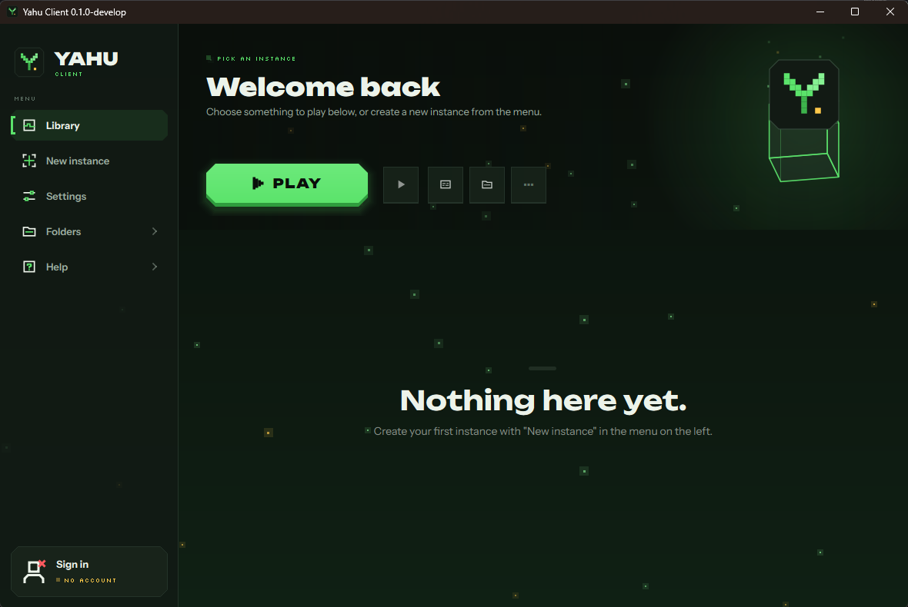

# Yahu Client

A private Minecraft launcher for me and a few friends, with its own look ("Night Grass") and lots of animation.

## What it is

Yahu Client is a desktop launcher that installs and starts the official Minecraft: Java Edition. It manages several separate
instances (versions, mod loaders such as Fabric, NeoForge or Quilt, mods from Modrinth) and starts the game with the player's
own account.

- **Sign-in:** Players sign in through the official Microsoft login page in their browser. The launcher receives a token
  only to verify game ownership and start Minecraft. Passwords never pass through the launcher.
- **No cheats, no server tricks:** The launcher starts the unmodified game. It doesn't change network traffic or game behaviour.
- **No data collection:** No telemetry, no accounts of its own, no backend. Everything stays on the player's PC
  (`%APPDATA%\YahuClient`).
- **Downloads** come only from official sources (Mojang/Microsoft, Modrinth, mod loader projects) and are checked against their hashes.

## Based on Prism Launcher

Yahu Client is a fork of the open-source launcher [Prism Launcher](https://github.com/PrismLauncher/PrismLauncher)
(itself based on PolyMC and MultiMC). The game logic comes from there; Yahu Client adds its own interface, theme, icons and
single-window navigation. Big thanks to the Prism Launcher, PolyMC and MultiMC contributors.

## Building

Windows build instructions, Microsoft login setup and notes are in [YAHU.md](YAHU.md).

## License

GPL-3.0, like Prism Launcher. See [LICENSE](LICENSE) and [COPYING.md](COPYING.md).
Fonts are licensed under the SIL Open Font License (`launcher/resources/yahu/fonts`).

Not an official Minecraft product. Not approved by or associated with Mojang or Microsoft.
