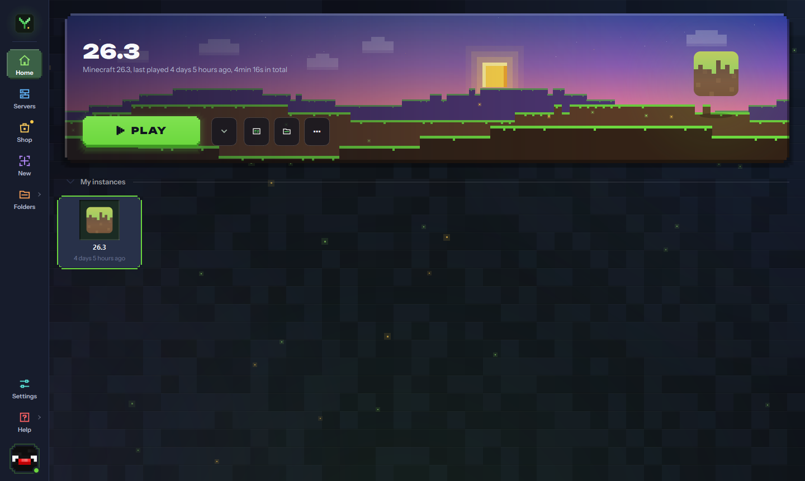

# Yahu Client

A Minecraft launcher for me and my friends, with its own colorful block look, lots of small animations and built-in server hosting.

## Download

Get the installer from the [latest release](https://github.com/Chrigu-san/YahuClient/releases/latest/download/YahuClient-Setup.exe)
(Windows 10/11, 64 bit). It needs no admin rights and puts Yahu Client on the desktop and in the Start menu.
The installer is not signed yet, so Windows may show "Windows protected your PC": click **More info**, then **Run anyway**.

## What it is

Yahu Client is a desktop launcher that installs and starts the official Minecraft: Java Edition. It manages several separate
instances (versions, mod loaders such as Fabric, NeoForge or Quilt, mods from Modrinth) and starts the game with the player's
own account.

- **Server hosting:** Create Paper, Vanilla or Fabric servers that run on your PC, with a console and a player list. While a
  server runs, Yahu Client opens its port on your router (UPnP) and shows the address friends can join with, so nobody has to
  set up port forwarding. The port is closed again when the server stops. Each server can get its own address like
  `chris.yahuclient.net`, so friends never have to type an IP. Servers never keep running unseen after the launcher closes
  or crashes.
- **In-game Yahu menu:** In Fabric instances for Minecraft 26.3 (with Fabric API), the launcher adds the small Yahu mod.
  It turns all of Minecraft's menus into slim smoked glass on a dark, blurred night background, with its own Yahu logo (own crisp font, glass
  buttons, fields and lists), and gives the main menu a new centered layout: the logo, a short column of slim buttons,
  an icon row at the bottom and a close X in the corner. The Yahu Mods button (in the button column of the title screen and pause menu) or Right Shift opens the Yahu menu with our own mods: a pixel-exact PvP crosshair, karaoke lyrics in the sky for
  the song you play in Spotify or your browser (line by line, word by word or kinetic), and custom skies (a black hole, a
  real-looking day, golden hour, aurora, nebula, or a picture of your own).
- **Sign-in:** Players sign in through the official Microsoft login page in their browser. The launcher receives a token
  only to verify game ownership and start Minecraft. Passwords never pass through the launcher.
- **No cheats, no server tricks:** The launcher starts the official game; the Yahu mod only draws things for the player
  (crosshair, lyrics, its menu). It doesn't change network traffic or what the game sends to servers.
- **No data collection:** No telemetry and no accounts of its own. Everything stays on the player's PC
  (`%APPDATA%\YahuClient`). The only Yahu service is the address service for server names: it stores the name, its
  current IP and port, nothing else. The lyrics mod, while it is on, asks [LRCLIB](https://lrclib.net) for the lyrics of
  the playing song (title, artist, album and length); no lyrics are stored in Yahu Client itself.
- **Downloads** come only from official sources (Mojang/Microsoft, Modrinth, mod loader projects) and are checked against their hashes.
  Server software is downloaded straight from Mojang, PaperMC and Fabric.

## Based on Prism Launcher

Yahu Client is a fork of the open-source launcher [Prism Launcher](https://github.com/PrismLauncher/PrismLauncher)
(itself based on PolyMC and MultiMC). The game logic comes from there; Yahu Client adds its own interface, theme, icons,
single-window navigation and server hosting. Big thanks to the Prism Launcher, PolyMC and MultiMC contributors.

## Building and contributing

Windows build instructions, tests, Microsoft login setup and the release steps are in [YAHU.md](YAHU.md).
`main` is protected: every change goes through a pull request.

## License

GPL-3.0, like Prism Launcher. See [LICENSE](LICENSE) and [COPYING.md](COPYING.md).
Fonts are licensed under the SIL Open Font License (`launcher/resources/yahu/fonts`).

Not an official Minecraft product. Not approved by or associated with Mojang or Microsoft.
